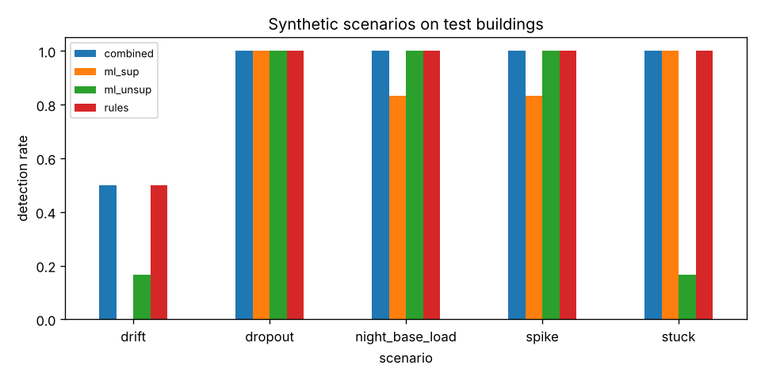
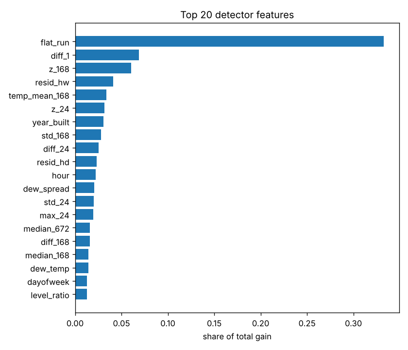
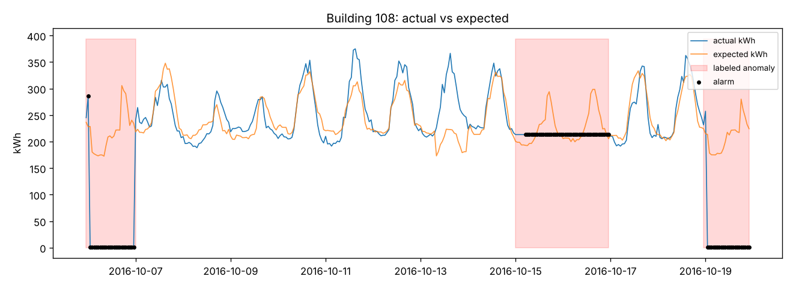

# ML results

Version `20261019-2152-2012a51`, chosen detector `lgbm` (quick run). Every number below is measured on the 6 held-out test buildings; thresholds were picked on the 6 validation buildings.

## Model comparison

| model | family | val_pr_auc | pr_auc | pr_auc_ci_low | pr_auc_ci_high | roc_auc | precision | recall | f1 | event_recall | event_precision | false_alarms_per_building_week |
|---|---|---|---|---|---|---|---|---|---|---|---|---|
| lgbm | supervised | 0.6626 | 0.8214 | 0.4478 | 0.9439 | 0.9603 | 0.9799 | 0.6857 | 0.8069 | 0.5106 | 0.8103 | 0.04519 |
| lgbm_hybrid | supervised | 0.6472 | 0.8211 | 0.4469 | 0.9419 | 0.9627 | 0.9695 | 0.6857 | 0.8033 | 0.5532 | 0.7812 | 0.05752 |
| lgbm_no_weather | supervised | 0.6554 | 0.8062 | 0.4446 | 0.9286 | 0.9435 | 0.9676 | 0.6782 | 0.7975 | 0.5319 | 0.7576 | 0.06574 |
| random_forest | supervised | 0.613 | 0.7972 | 0.4031 | 0.9298 | 0.9424 | 0.9514 | 0.6976 | 0.805 | 0.5957 | 0.7794 | 0.06163 |
| rules | rules | 0.3425 | 0.5719 | 0.1783 | 0.7268 | 0.8465 | 0.8501 | 0.6188 | 0.7163 | 0.3191 | 0.4545 | 0.1479 |
| isolation_forest | unsupervised | 0.4494 | 0.5579 | 0.231 | 0.7277 | 0.9247 | 0.9914 | 0.3726 | 0.5416 | 0.2979 | 0.9032 | 0.01233 |
| expected_residual | unsupervised | 0.3963 | 0.4732 | 0.1691 | 0.5731 | 0.7263 | 1 | 0.3499 | 0.5184 | 0.1915 | 1 | 0 |

## Day level

A building-day is anomalous if any labeled hour is and alarmed if any hour alarms, as in the LEAD paper. See [lead-benchmark.md](../../docs/rapor/lead-benchmark.md) before comparing with the paper.

| model | day_pr_auc | day_precision | day_recall | day_f1 |
|---|---|---|---|---|
| lgbm | 0.6414 | 0.8065 | 0.4762 | 0.5988 |
| lgbm_hybrid | 0.6337 | 0.7826 | 0.5143 | 0.6207 |
| lgbm_no_weather | 0.6242 | 0.7761 | 0.4952 | 0.6047 |
| random_forest | 0.6643 | 0.7763 | 0.5619 | 0.6519 |
| rules | 0.3062 | 0.5147 | 0.3333 | 0.4046 |
| isolation_forest | 0.4718 | 0.9032 | 0.2667 | 0.4118 |
| expected_residual | 0.4421 | 1 | 0.1714 | 0.2927 |

## Expected-consumption model (normal test hours)

| mae_kwh | median_ape | wape |
|---|---|---|
| 8.509 | 0.09037 | 0.1022 |

## Combined product alarm (rule OR detector OR residual)

| precision | recall | f1 | event_recall | event_precision | alarms_per_building_week | false_alarms_per_building_week |
|---|---|---|---|---|---|---|
| 0.5258 | 0.6382 | 0.5766 | 0.5745 | 0.3006 | 0.7108 | 0.4971 |

Alarm source shares: rule 79%, ml_sup 4%, ml_unsup 17%.

## Alarm budget

Threshold chosen on validation for a target alarm rate, then applied to test.

| budget_per_building_week | detector_threshold | residual_threshold | precision | recall | f1 | event_recall | event_precision | alarms_per_building_week | false_alarms_per_building_week |
|---|---|---|---|---|---|---|---|---|---|
| 0.5 | 0.4466 | 5.128 | 0.8922 | 0.7333 | 0.805 | 0.6383 | 0.5728 | 0.4232 | 0.1808 |
| 1 | 0.2247 | 3.905 | 0.7569 | 0.7732 | 0.765 | 0.7128 | 0.3472 | 0.793 | 0.5177 |
| 2 | 0.08546 | 2.541 | 0.5047 | 0.811 | 0.6222 | 0.7872 | 0.1534 | 1.956 | 1.656 |
| 3 | 0.04216 | 1.971 | 0.3353 | 0.8423 | 0.4797 | 0.8617 | 0.08876 | 3.657 | 3.332 |
| 5 | 0.01717 | 1.477 | 0.1979 | 0.8844 | 0.3234 | 0.8936 | 0.05533 | 6.163 | 5.822 |
| 10 | 0.001795 | 0.8954 | 0.04356 | 0.9795 | 0.0834 | 1 | 0.03295 | 9.725 | 9.405 |

## Synthetic scenarios

Waste and meter faults injected into test buildings (LEAD labels are mostly drops).

| scenario | detector | injections | detection_rate | hourly_recall | median_hours_to_detect |
|---|---|---|---|---|---|
| spike | rules | 6 | 1 | 0.9444 | 0 |
| spike | ml_sup | 6 | 0.8333 | 0.3889 | 0 |
| spike | ml_unsup | 6 | 1 | 1 | 0 |
| spike | combined | 6 | 1 | 1 | 0 |
| dropout | rules | 6 | 1 | 1 | 0 |
| dropout | ml_sup | 6 | 1 | 0.9792 | 0 |
| dropout | ml_unsup | 6 | 1 | 1 | 0 |
| dropout | combined | 6 | 1 | 1 | 0 |
| stuck | rules | 6 | 1 | 0.7917 | 5 |
| stuck | ml_sup | 6 | 1 | 0.7639 | 6 |
| stuck | ml_unsup | 6 | 0.1667 | 0.07639 | 10 |
| stuck | combined | 6 | 1 | 0.7917 | 5 |
| drift | rules | 6 | 0.5 | 0.01339 | 208 |
| drift | ml_sup | 6 | 0 | 0 |  |
| drift | ml_unsup | 6 | 0.1667 | 0.0009921 | 299 |
| drift | combined | 6 | 0.5 | 0.0124 | 208 |
| night_base_load | rules | 6 | 1 | 1 | 2.5 |
| night_base_load | ml_sup | 6 | 0.8333 | 0.08333 | 17 |
| night_base_load | ml_unsup | 6 | 1 | 0.6429 | 2.5 |
| night_base_load | combined | 6 | 1 | 0.996 | 2.5 |

## Top features

| feature | gain | share |
|---|---|---|
| flat_run | 1.178e+05 | 0.3327 |
| diff_1 | 2.431e+04 | 0.06869 |
| z_168 | 2.139e+04 | 0.06043 |
| resid_hw | 1.45e+04 | 0.04097 |
| temp_mean_168 | 1.193e+04 | 0.03371 |
| z_24 | 1.12e+04 | 0.03165 |
| year_built | 1.079e+04 | 0.03048 |
| std_168 | 9,814 | 0.02773 |
| diff_24 | 8,929 | 0.02523 |
| resid_hd | 8,198 | 0.02317 |
| hour | 7,929 | 0.0224 |
| dew_spread | 7,345 | 0.02075 |
| std_24 | 7,096 | 0.02005 |
| max_24 | 6,895 | 0.01948 |
| median_672 | 5,733 | 0.0162 |

## Example building

## Costliest test events (173 events, 5,478 kWh above expected)

| building_id | ts_start | source | explanation |
|---|---|---|---|
| 108 | 2016-09-24 14:00:00 | rule | 2016-09-24 14:00-19:00: Weekend or holiday load was 1.6x the same hour in recent weeks. About 689 kWh above expected (2,410 TL at 3.5 TL/kWh). |
| 149 | 2016-06-18 18:00:00 | rule | 2016-06-18 18:00-00:00: Meter repeated the same value for at least 35 hours; it may be stuck. About 294 kWh above expected (1,031 TL at 3.5 TL/kWh). |
| 136 | 2016-03-05 16:00:00 | rule | 2016-03-05 16:00-00:00: Weekend or holiday load was 5.4x the same hour in recent weeks. About 230 kWh above expected (805 TL at 3.5 TL/kWh). |
| 108 | 2016-08-14 01:00:00 | rule | 2016-08-14 01:00-03:00: Night load was 1.5x the same hour in recent weeks. About 208 kWh above expected (728 TL at 3.5 TL/kWh). |
| 108 | 2016-06-08 02:00:00 | rule | 2016-06-08 02:00-04:00: Night load was 1.5x the same hour in recent weeks. About 200 kWh above expected (699 TL at 3.5 TL/kWh). |
| 108 | 2016-06-18 17:00:00 | rule | 2016-06-18 17:00-00:00: Meter repeated the same value for at least 35 hours; it may be stuck. About 193 kWh above expected (676 TL at 3.5 TL/kWh). |
| 108 | 2016-10-15 05:00:00 | rule | 2016-10-15 05:00-00:00: Meter repeated the same value for at least 48 hours; it may be stuck. About 183 kWh above expected (639 TL at 3.5 TL/kWh). |
| 108 | 2016-10-30 01:00:00 | ml_sup | 2016-10-30 01:00-02:00: Pattern matches anomalies labeled in historical data. About 177 kWh above expected (618 TL at 3.5 TL/kWh). |
| 108 | 2016-06-26 16:00:00 | rule | 2016-06-26 16:00-18:00: Weekend or holiday load was 1.5x the same hour in recent weeks. About 174 kWh above expected (609 TL at 3.5 TL/kWh). |
| 136 | 2016-03-04 17:00:00 | ml_unsup | 2016-03-04 17:00-23:00: Consumption was 2.1x the expected level. About 156 kWh above expected (545 TL at 3.5 TL/kWh). |
