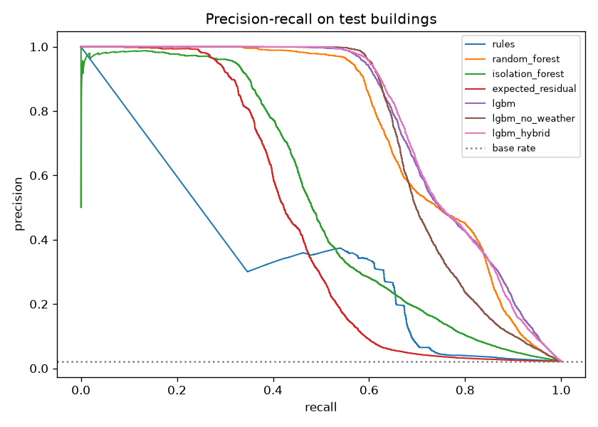

# ML results

Version `20261023-1958-0e010a3`, chosen detector `lgbm`. Every number below is measured on the 30 held-out test buildings; thresholds were picked on the 30 validation buildings.

## Model comparison

| model | family | val_pr_auc | pr_auc | pr_auc_ci_low | pr_auc_ci_high | roc_auc | precision | recall | f1 | event_recall | event_precision | false_alarms_per_building_week |
|---|---|---|---|---|---|---|---|---|---|---|---|---|
| lgbm_hybrid | supervised | 0.8466 | 0.7732 | 0.6552 | 0.8998 | 0.9645 | 0.8241 | 0.652 | 0.728 | 0.4209 | 0.6654 | 0.1162 |
| lgbm | supervised | 0.8527 | 0.7714 | 0.6554 | 0.9021 | 0.9659 | 0.7381 | 0.6649 | 0.6996 | 0.4544 | 0.5858 | 0.1715 |
| random_forest | supervised | 0.8029 | 0.7468 | 0.5997 | 0.8932 | 0.9526 | 0.8348 | 0.6036 | 0.7006 | 0.4269 | 0.754 | 0.07381 |
| lgbm_no_weather | supervised | 0.8304 | 0.7315 | 0.6154 | 0.843 | 0.9442 | 0.604 | 0.6765 | 0.6382 | 0.4856 | 0.4114 | 0.3724 |
| isolation_forest | unsupervised | 0.6219 | 0.526 | 0.4299 | 0.6212 | 0.8948 | 0.92 | 0.3388 | 0.4952 | 0.2122 | 0.7854 | 0.03212 |
| expected_residual | unsupervised | 0.5455 | 0.451 | 0.3611 | 0.5405 | 0.7651 | 0.7911 | 0.3541 | 0.4892 | 0.2146 | 0.6718 | 0.05809 |
| rules | rules | 0.2506 | 0.2251 | 0.0891 | 0.6035 | 0.8128 | 0.3424 | 0.5777 | 0.4299 | 0.2038 | 0.209 | 0.4319 |

## Day level

A building-day is anomalous if any labeled hour is and alarmed if any hour alarms, as in the LEAD paper. See [lead-benchmark.md](../../docs/rapor/lead-benchmark.md) before comparing with the paper.

| model | day_pr_auc | day_precision | day_recall | day_f1 |
|---|---|---|---|---|
| lgbm_hybrid | 0.7364 | 0.7375 | 0.5573 | 0.6348 |
| lgbm | 0.7293 | 0.6801 | 0.588 | 0.6307 |
| random_forest | 0.7529 | 0.7896 | 0.5503 | 0.6486 |
| lgbm_no_weather | 0.6833 | 0.4983 | 0.6243 | 0.5542 |
| isolation_forest | 0.4961 | 0.8477 | 0.2877 | 0.4296 |
| expected_residual | 0.4399 | 0.7376 | 0.2905 | 0.4168 |
| rules | 0.198 | 0.3115 | 0.3589 | 0.3335 |

## Expected-consumption model (normal test hours)

| mae_kwh | median_ape | wape |
|---|---|---|
| 9.533 | 0.07003 | 0.09084 |

## Combined product alarm (rule OR detector OR residual)

| precision | recall | f1 | event_recall | event_precision | alarms_per_building_week | false_alarms_per_building_week |
|---|---|---|---|---|---|---|
| 0.2628 | 0.7379 | 0.3876 | 0.5552 | 0.2226 | 1.323 | 1.029 |

Alarm source shares: rule 82%, ml_sup 3%, ml_unsup 15%.

## Alarm budget

Threshold chosen on validation for a target alarm rate, then applied to test.

| budget_per_building_week | detector_threshold | residual_threshold | precision | recall | f1 | event_recall | event_precision | alarms_per_building_week | false_alarms_per_building_week |
|---|---|---|---|---|---|---|---|---|---|
| 0.5 | 0.5261 | 5.817 | 0.5737 | 0.7166 | 0.6373 | 0.5731 | 0.5133 | 0.5898 | 0.287 |
| 1 | 0.07934 | 4.072 | 0.4005 | 0.8158 | 0.5373 | 0.777 | 0.3164 | 1.214 | 0.8296 |
| 2 | 0.01783 | 2.714 | 0.2711 | 0.8798 | 0.4145 | 0.8645 | 0.1624 | 2.491 | 2.086 |
| 3 | 0.008712 | 2.176 | 0.1979 | 0.9038 | 0.3247 | 0.8921 | 0.1146 | 3.613 | 3.199 |
| 5 | 0.003743 | 1.646 | 0.1305 | 0.9354 | 0.2291 | 0.9281 | 0.07887 | 5.259 | 4.845 |
| 10 | 0.0008721 | 1.033 | 0.06035 | 0.9731 | 0.1137 | 0.9688 | 0.04618 | 8.835 | 8.427 |

## Synthetic scenarios

Waste and meter faults injected into test buildings (LEAD labels are mostly drops).

| scenario | detector | injections | detection_rate | hourly_recall | median_hours_to_detect |
|---|---|---|---|---|---|
| spike | rules | 30 | 0.8667 | 0.7889 | 0 |
| spike | ml_sup | 30 | 0.1 | 0.06667 | 0 |
| spike | ml_unsup | 30 | 0.9667 | 0.9556 | 0 |
| spike | combined | 30 | 0.9667 | 0.9556 | 0 |
| dropout | rules | 30 | 1 | 1 | 0 |
| dropout | ml_sup | 30 | 0.8667 | 0.3583 | 10.5 |
| dropout | ml_unsup | 30 | 1 | 0.9861 | 0 |
| dropout | combined | 30 | 1 | 1 | 0 |
| stuck | rules | 30 | 1 | 0.8083 | 5 |
| stuck | ml_sup | 30 | 0.7 | 0.3181 | 11 |
| stuck | ml_unsup | 30 | 0.4 | 0.1389 | 5.5 |
| stuck | combined | 30 | 1 | 0.8194 | 5 |
| drift | rules | 30 | 0.5667 | 0.03254 | 156 |
| drift | ml_sup | 30 | 0 | 0 |  |
| drift | ml_unsup | 30 | 0.1667 | 0.003274 | 170 |
| drift | combined | 30 | 0.4667 | 0.03105 | 98.5 |
| night_base_load | rules | 30 | 1 | 1 | 6.5 |
| night_base_load | ml_sup | 30 | 0.03333 | 0.001587 | 1 |
| night_base_load | ml_unsup | 30 | 1 | 0.6921 | 6.5 |
| night_base_load | combined | 30 | 1 | 1 | 6.5 |

## Top features

| feature | gain | share |
|---|---|---|
| level_ratio | 3.338e+05 | 0.1621 |
| flat_run | 3.224e+05 | 0.1566 |
| lag_1 | 2.642e+05 | 0.1283 |
| min_24 | 7.984e+04 | 0.03877 |
| z_168 | 7.336e+04 | 0.03563 |
| log_sqft | 6.942e+04 | 0.03372 |
| temp_mean_168 | 6.605e+04 | 0.03208 |
| diff_1 | 6.363e+04 | 0.0309 |
| log_kwh | 6.089e+04 | 0.02957 |
| resid_hw | 5.874e+04 | 0.02853 |
| std_168 | 4.127e+04 | 0.02004 |
| resid_hd | 3.59e+04 | 0.01744 |
| dew_spread | 3.562e+04 | 0.0173 |
| z_24 | 3.488e+04 | 0.01694 |
| std_24 | 3.436e+04 | 0.01669 |

## Example building

## Costliest test events (857 waste events, 121,778 kWh above expected; 238 meter faults without cost)

| building_id | ts_start | source | explanation |
|---|---|---|---|
| 687 | 2016-11-07 09:00:00 | rule | 2016-11-07 09:00-2016-11-10 15:00: Gece tüketimi son haftalardaki aynı saatin 9,3 katına çıktı. Beklenenden yaklaşık 4.335 kWh fazla (3,50 TL/kWh ile 15.171 TL). |
| 1318 | 2016-08-12 14:00:00 | ml_sup | 2016-08-12 14:00-14:00: Tüketim deseni geçmişte etiketlenmiş anomalilere benziyor. Beklenenden yaklaşık 2.932 kWh fazla (3,50 TL/kWh ile 10.262 TL). |
| 890 | 2016-05-11 15:00:00 | rule | 2016-05-11 15:00-17:00: Tüketim haftalık medyanın 5,6 katına sıçradı. Beklenenden yaklaşık 1.731 kWh fazla (3,50 TL/kWh ile 6.057 TL). |
| 1068 | 2016-09-11 06:00:00 | rule | 2016-09-11 06:00-21:00: Hafta sonu veya tatil tüketimi son haftalardaki aynı saatin 3,0 katı oldu. Beklenenden yaklaşık 1.707 kWh fazla (3,50 TL/kWh ile 5.973 TL). |
| 1068 | 2016-07-03 04:00:00 | rule | 2016-07-03 04:00-22:00: Hafta sonu veya tatil tüketimi son haftalardaki aynı saatin 2,4 katı oldu. Beklenenden yaklaşık 1.595 kWh fazla (3,50 TL/kWh ile 5.583 TL). |
| 1068 | 2016-09-03 06:00:00 | rule | 2016-09-03 06:00-22:00: Hafta sonu veya tatil tüketimi son haftalardaki aynı saatin 3,0 katı oldu. Beklenenden yaklaşık 1.585 kWh fazla (3,50 TL/kWh ile 5.547 TL). |
| 1068 | 2016-04-03 06:00:00 | rule | 2016-04-03 06:00-21:00: Hafta sonu veya tatil tüketimi son haftalardaki aynı saatin 3,6 katı oldu. Beklenenden yaklaşık 1.569 kWh fazla (3,50 TL/kWh ile 5.492 TL). |
| 1068 | 2016-12-04 05:00:00 | rule | 2016-12-04 05:00-21:00: Hafta sonu veya tatil tüketimi son haftalardaki aynı saatin 3,0 katı oldu. Beklenenden yaklaşık 1.522 kWh fazla (3,50 TL/kWh ile 5.327 TL). |
| 1247 | 2016-01-17 11:00:00 | rule | 2016-01-17 11:00-21:00: Hafta sonu veya tatil tüketimi son haftalardaki aynı saatin 3,1 katı oldu. Beklenenden yaklaşık 1.519 kWh fazla (3,50 TL/kWh ile 5.317 TL). |
| 1068 | 2016-04-10 08:00:00 | rule | 2016-04-10 08:00-21:00: Hafta sonu veya tatil tüketimi son haftalardaki aynı saatin 3,8 katı oldu. Beklenenden yaklaşık 1.475 kWh fazla (3,50 TL/kWh ile 5.164 TL). |
